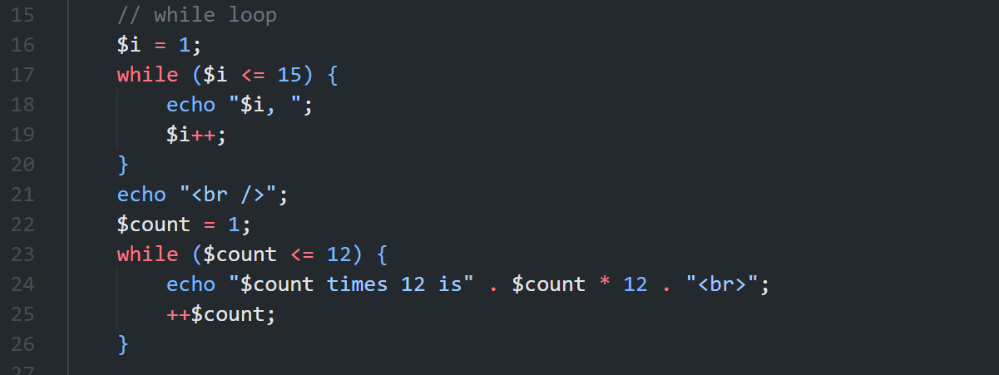
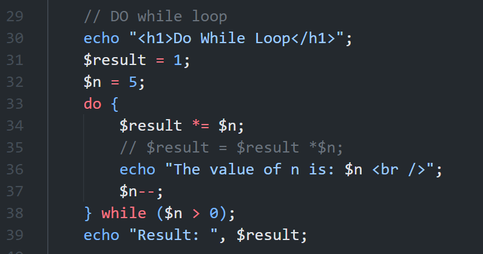
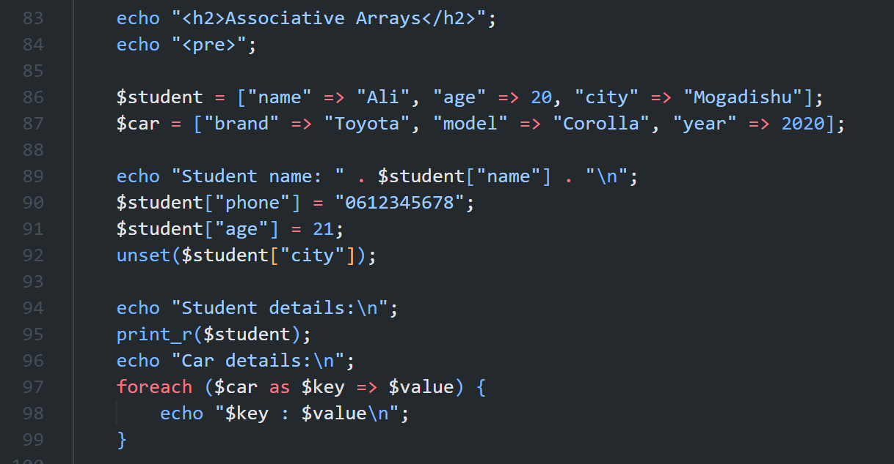

# Week 2: Loops and Arrays

This folder contains practice screenshots for **Web Application Development - PHP & MySQL**. The examples cover PHP loops and arrays.

## Week 2 Practice Screenshots

The screenshots document the examples in `Week2/index.php`.

## 1. While Loop and Multiplication

**Screenshot:** `PHP_While_Loop_Practice.png`

This example uses a `while` loop to print numbers from 1 to 15. The screenshot description also mentions calculating multiples of 12.

### Code example

```php
$i = 1;

while ($i <= 15) {
    echo "$i, ";
    $i++;
}
```

### Screenshot



---

## 2. Do-While and Nested Loops

**Screenshot:** `PHP_Do_While_Nested_Loops.png`

This example uses a `do-while` loop to calculate a factorial and nested `for` loops to display multiplication output.

### Code example

```php
$result = 1;
$n = 5;

do {
    $result *= $n;
    $n--;
} while ($n > 0);
```

### Screenshot



---

## 3. Numeric Arrays

**Screenshot:** `PHP_Numeric_Arrays.png`

This example demonstrates creating a numeric array, looping through its values, and displaying the array with `print_r()`.

### Code example

```php
$numbers = array(2, 3, 4, 6, 7);

foreach ($numbers as $number) {
    echo "$number<br>";
}

print_r($numbers);
```

### Screenshot


---

## 4. Associative Arrays

**Screenshot:** `PHP_Associative_Arrays.png`

This example demonstrates creating an associative array, adding and updating values, removing a value, and looping through key-value pairs.

### Code example

```php
$student = [
    "name" => "Ali",
    "age" => 20,
    "city" => "Mogadishu"
];

$student["phone"] = "0612345678";
$student["age"] = 21;

unset($student["city"]);

print_r($student);
```

### Screenshot



---

## 5. Nested Arrays and Array Functions

**Screenshot:** `PHP_Nested_Arrays_Functions.png`

This example demonstrates a developer profile with a nested skills array, student records, and array functions such as `count()`, `array_keys()`, and `array_values()`.

### Code example

```php
$developer = [
    "name" => "Qasim Nuur",
    "role" => "Developer",
    "skills" => ["PHP", "HTML", "CSS"]
];

echo $developer["skills"][0];
print_r(array_keys($developer));
```

### Screenshot


---

## Learning Goals

By practicing these examples, you can learn how to:

- Repeat tasks with `while`, `do-while`, and `for` loops.
- Work with numeric and associative arrays.
- Use `foreach` to read array values.
- Store nested data in arrays.
- Use common array functions.

## Note

Keep the screenshot files in the same folder as this README so the images display correctly. The code snippets are practice examples; run the complete PHP code from your `index.php` file using a local PHP server such as XAMPP.
